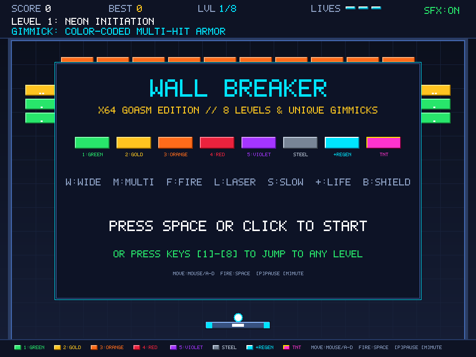
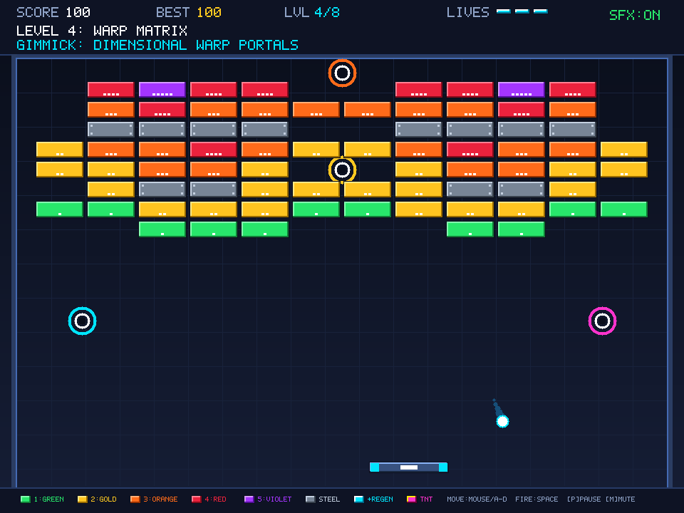
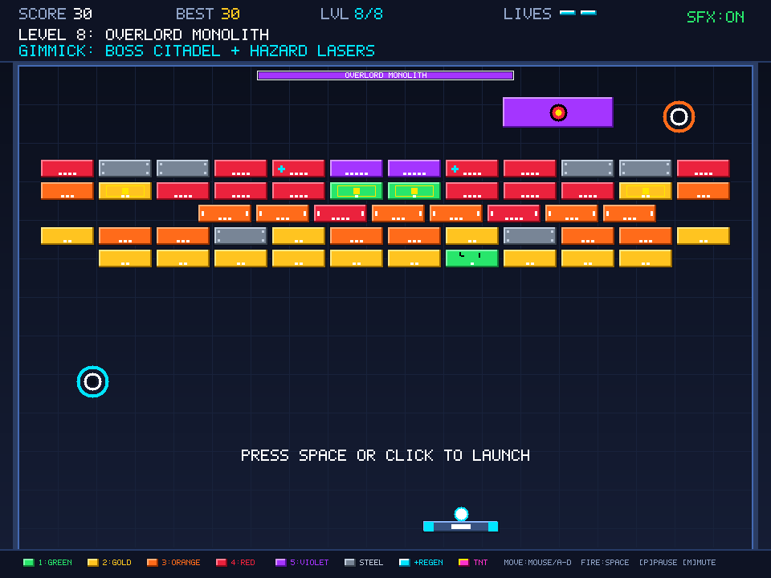
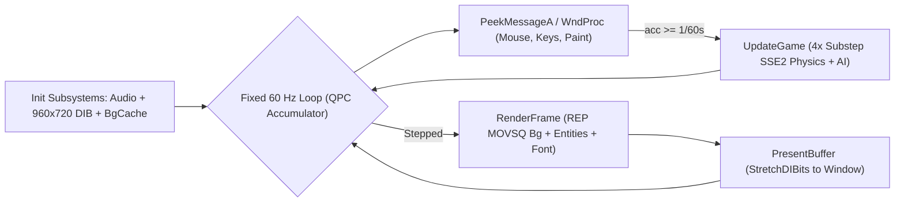
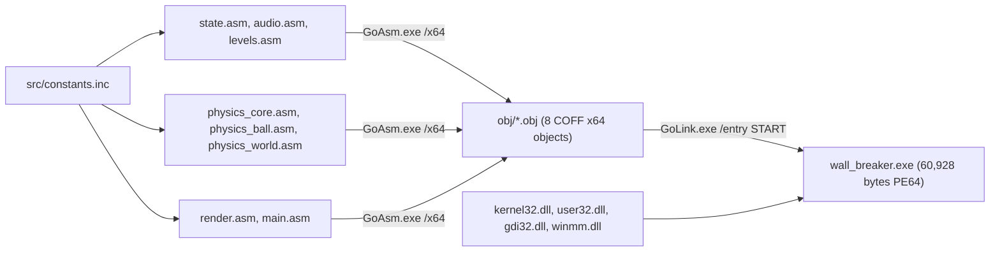

<div align="center">

# WALL BREAKER // x64 GoAsm Edition

**A complete, level-based arcade Wall Breaker written in 100% pure x64 Windows Assembly (`GoAsm` + `GoLink`).**

-00E5FF?style=for-the-badge)


*No C runtime. No external sprites. No external audio `.wav` files. Just hand-crafted Win64 assembly, SSE2 floating-point physics, a custom 32-bpp software renderer, and procedural sound synthesis.*

[Quick Start](#quick-start) • [Screenshots](#screenshots) • [Walls & Power-Ups](#color-coded-walls--power-ups) • [8 Escalating Levels](#8-escalating-levels--gimmicks) • [How It Works](#how-it-works-under-the-hood) • [How It Compiles](#how-it-is-compiled)

</div>

---

## Screenshots

| Title Screen & Wall Legend | Level 4: Dimensional Warp Matrix | Level 8: Overlord Monolith Boss |
| :---: | :---: | :---: |
|  |  |  |
| *Color key, 7 power-ups & direct `1`–`8` level jump* | *Paired Cyan/Orange & Magenta/Gold warp portals* | *24-HP moving citadel boss firing crimson hazard bolts* |

---

## Quick Start

### Run Pre-Built Game
[`wall_breaker.exe`](wall_breaker.exe) is standalone and links only against standard Windows system DLLs (`kernel32.dll`, `user32.dll`, `gdi32.dll`, `winmm.dll`):

```powershell
cd c:\Users\slevi\Documents\wall_breaker
.\wall_breaker.exe
```

### Controls

| Action | Keys / Input |
| :--- | :--- |
| **Move Paddle** | Mouse cursor, `A` / `D`, or `Left` / `Right` Arrow |
| **Start / Launch Ball / Fire Dual Lasers** | `Space` or `Left Mouse Click` |
| **Jump Directly to Level 1–8** *(Title Screen)* | Number keys `1` through `8` |
| **Pause / Resume** | `P` (or `Esc` during gameplay) |
| **Restart Campaign** | `R` |
| **Toggle Procedural SFX** | `M` |
| **Quit** *(Title / Intro / End Screen)* | `Esc` or Window Close (`X`) |

> [!TIP]
> Input uses latched `WM_KEYDOWN`/`WM_KEYUP` state inside [`WndProc`](src/main.asm) combined with foreground-checked `GetAsyncKeyState`, so fast taps between frames are never dropped and alt-tabbing out cleanly clears held keys.

---

## Color-Coded Walls & Power-Ups

### Brick Colors by Remaining Hits (`HP`)

Every breakable brick dynamically changes its fill color, top/bottom bezel shading, white hit pips, and damage cracks each time it takes damage:

| Code / HP | Brick Color & Visual Marker | Behavior |
| :---: | :--- | :--- |
| **`1 HP`** | **Emerald Green** · `1` white pip | Shatters on the next impact |
| **`2 HP`** | **Amber Gold** · `2` white pips | Drops to Emerald Green on hit |
| **`3 HP`** | **Tangerine Orange** · `3` white pips | Drops down through Gold → Green |
| **`4 HP`** | **Crimson Red** · `4` white pips | Drops down through Orange → Gold → Green |
| **`5+ HP`** | **Royal Violet** · `5` white pips | Drops down tier-by-tier with dark crack notches once damaged |
| **`STEEL`** | **Chrome Grey** · 4 corner metallic rivets | Indestructible (`HP = 255`); deflects balls and lasers |
| **`+REGEN`** | **Pulsing Cyan `+` Cross** + HP color | Restores `+1 HP` every `270` frames (~4.5s) if left wounded |
| **`TNT`** | **Glowing Yellow Core Frame** + HP color | Chain-detonates nearby breakable bricks within `108 px` |

### 7 Falling Power-Up Capsules

Destroyed bricks have a chance to drop colored lettered capsules (`28%` drop probability):

| Capsule | Name | Effect & Duration |
| :---: | :--- | :--- |
| **`W`** | **Wide Paddle** | Smoothly expands paddle width by `1.55×` for `720` frames (`12s`) |
| **`M`** | **Multi-Ball** | Clones up to `2` additional angled balls from an active ball (up to `8` concurrent balls) |
| **`F`** | **Fireball Pierce** | Balls glow orange-red and smash straight through destroyed bricks for `600` frames (`10s`) |
| **`L`** | **Dual Lasers** | Equips twin yellow laser emitters on the paddle tips (`Space` / Click fires) for `660` frames (`11s`) |
| **`S`** | **Slow Ball** | Scales ball velocity by `0.72×` for precision control for `600` frames (`10s`) |
| **`+`** | **Extra Life** | Grants `+1` life (capped at `5` lives) plus `+100` bonus points |
| **`B`** | **Safety Barrier** | Activates a glowing gold bottom floor shield that saves missed balls for `720` frames (`12s`) |

---

## 8 Escalating Levels & Gimmicks

Difficulty ramps up every stage across four axes: **ball base speed**, **narrower paddle width**, **tougher multi-hit walls**, and a **unique stage mechanic**.

| Lvl | Stage Name | Ball Speed | Paddle Width | Stage Gimmick & Tactical Twist |
| :-: | :--- | :---: | :---: | :--- |
| **1** | **NEON INITIATION** | `5.2` | `132 px` | Multi-hit color tiers (`1`–`3 HP`) & falling capsules |
| **2** | **IRON BASTION** | `5.7` | `124 px` | Indestructible Chrome Steel barricades & banked entry chutes |
| **3** | **SHIFTING PHALANX** | `6.2` | `118 px` | Horizontally patrolling brick rows bouncing within lane bounds |
| **4** | **WARP MATRIX** | `6.6` | `112 px` | Paired dimensional portals (`Cyan ↔ Orange`, `Magenta ↔ Gold`) bypassing steel vaults |
| **5** | **BIO-CORE REACTOR** | `7.0` | `108 px` | Self-healing `+REGEN` bricks regenerating HP if left half-broken |
| **6** | **PINBALL CITADEL** | `7.4` | `104 px` | 4 Repulsor Bumpers that deflect balls outward & boost speed (`1.05×`, capped at `11.8`) |
| **7** | **SINGULARITY CHAIN** | `7.8` | `100 px` | Central Gravity Anomaly Well curving trajectories + `TNT` chain-reaction blasts |
| **8** | **OVERLORD MONOLITH** | `8.2` | `96 px` | Moving `24-HP` Citadel Boss firing downward crimson stun bolts + tactical portals, steel, regen, moving, and TNT bricks |

---

## How It Works (Under the Hood)

Everything runs inside a pure Win64 assembly loop starting at `START` in [`src/main.asm`](src/main.asm) with zero C runtime (`msvcrt`):



### Core Subsystems

1. **Software 32-bpp DIB Renderer ([`render.asm`](src/render.asm) + [`main.asm`](src/main.asm))**
   - Calls `SetProcessDPIAware` and inspects desktop work area via `SystemParametersInfoA(SPI_GETWORKAREA)` so the `960×720` logical canvas fits cleanly on scaled laptop screens.
   - Creates a top-down 32-bpp ARGB pixel buffer (`biHeight = -720`) via `CreateDIBSection`.
   - At startup, [`InitBackgroundCache`](src/render.asm) allocates `2,764,800` bytes (`VirtualAlloc`) and pre-renders the vertical gradient, cyber grid, arena borders, and bottom legend bar. Every rendered frame blits the cached backdrop to `[gPixels]` in a single `REP MOVSQ` (`345,600` QWORDs) before layering HUD, gravity rings, portals, bumpers, bricks, boss, paddle, ball trails, particles, popups, and overlays.
   - Text is rendered without `GDI` font handles using an embedded `5×7` bitmap pixel font (`gFont5x7`, ASCII `32`–`95`) in [`state.asm`](src/state.asm).

2. **64-bit SSE2 Substepped Physics ([`physics_ball.asm`](src/physics_ball.asm), [`physics_core.asm`](src/physics_core.asm), [`physics_world.asm`](src/physics_world.asm))**
   - Floating-point positions, velocities, radii, and gravity vectors use double-precision (`DQ`) IEEE-754 SSE2 scalar instructions (`MOVSD`, `ADDSD`, `MULSD`, `DIVSD`, `SQRTSD`, `UCOMISD`, `CVTTSD2SI`).
   - Each `60 Hz` tick advances active balls in **`4` substeps** (`0.25 × slowScale`) to prevent high-speed tunneling through thin bricks, barriers, or portals.
   - Ball deflections normalize direction vectors (`NormalizeBallVel`), enforce minimum vertical velocity ratios (`fMinVyRatio = 0.36`) to prevent horizontal infinite loops, and update 6-entry ball trail ring buffers.

3. **Zero-Asset Procedural Audio ([`audio.asm`](src/audio.asm))**
   - Allocates a `64 KB` (`65,536`-byte) heap block via `VirtualAlloc` and synthesizes **9 complete `RIFF`/`WAVE` sound files in RAM** (`22050 Hz`, 8-bit unsigned mono PCM) at startup using frequency-swept square waves, Xorshift64 noise bursts, and 4-note arpeggios (`BuildWavTone`, `BuildWavArp`):
     - `SFX_PADDLE`, `SFX_BRICK`, `SFX_STEEL`, `SFX_BREAK`, `SFX_POWERUP`, `SFX_LASER`, `SFX_EXPLODE`, `SFX_LOSE`, `SFX_LEVELUP`.
   - Playback triggers instantaneously via `PlaySoundA(ptr, 0, SND_MEMORY | SND_ASYNC | SND_NODEFAULT)`.

---

## How It Is Compiled

### Modular Build Pipeline

`GoAsm.exe` automatically exports all non-local symbols across COFF object files, while **modular assembly** keeps every translation unit compact, fast to assemble, and well under GoAsm's internal single-unit symbol/table capacity:



### Build Steps ([`build.bat`](build.bat))

1. **Locate Toolchain**: Checks `PATH` for `goasm.exe` / `golink.exe`, falling back to `C:\Users\slevi\Downloads\ECGo\GoAsm\Bin\`.
2. **Assemble Each Module Independently**:
   Runs `GoAsm.exe /x64 /fo obj\<module>.obj <module>.asm` across all 8 `.asm` files inside `src\` (`state`, `audio`, `levels`, `physics_core`, `physics_ball`, `physics_world`, `render`, `main`), checking `!errorlevel! neq 0` so negative Windows exception codes also fail loudly.
3. **Link Pure Win64 Executable**:
   Runs `GoLink.exe /entry START /fo wall_breaker.exe <8 .obj files> kernel32.dll user32.dll gdi32.dll winmm.dll` — no import `.lib` files required because GoLink resolves Win32 API symbols directly from DLL names.
4. **Cleanup**: Removes the temporary `obj\` directory on completion, leaving a clean `wall_breaker.exe` binary.

To rebuild after modifying assembly source:
```bat
build.bat
```

---

## Repository Layout

```text
wall_breaker/
├── build.bat                  # 8-module GoAsm /x64 + GoLink build script
├── wall_breaker.exe           # Standalone 60.9 KB Win64 game binary
├── LICENSE                    # GNU General Public License v3.0
├── README.md                  # Project documentation
├── docs/
│   └── screenshots/           # Live captured 960x720 game frames
│       ├── title.png
│       ├── level4_portals.png
│       └── level8_boss.png
└── src/
    ├── constants.inc          # Win64 structs, virtual keys, dimensions, palette
    ├── state.asm              # Global constants, 5x7 font, palettes, entity pools
    ├── audio.asm              # 9 procedural in-memory PCM WAV effects
    ├── levels.asm             # 8 level layouts & per-level gimmick initializers
    ├── physics_core.asm       # PRNG, score, popups, bursts, power-ups, TNT blasts
    ├── physics_ball.asm       # 4x substepped ball kinematics, portals, bumpers, collisions
    ├── physics_world.asm      # Boss AI, brick updates, projectiles, input & game tick
    ├── render.asm             # 32-bpp software renderer, beveled bricks, HUD & overlays
    └── main.asm               # Win64 entry point (START), WndProc, DIB & 60 Hz QPC loop
```

---

## License

Distributed under the **GNU General Public License v3.0**. See [`LICENSE`](LICENSE) for details.
